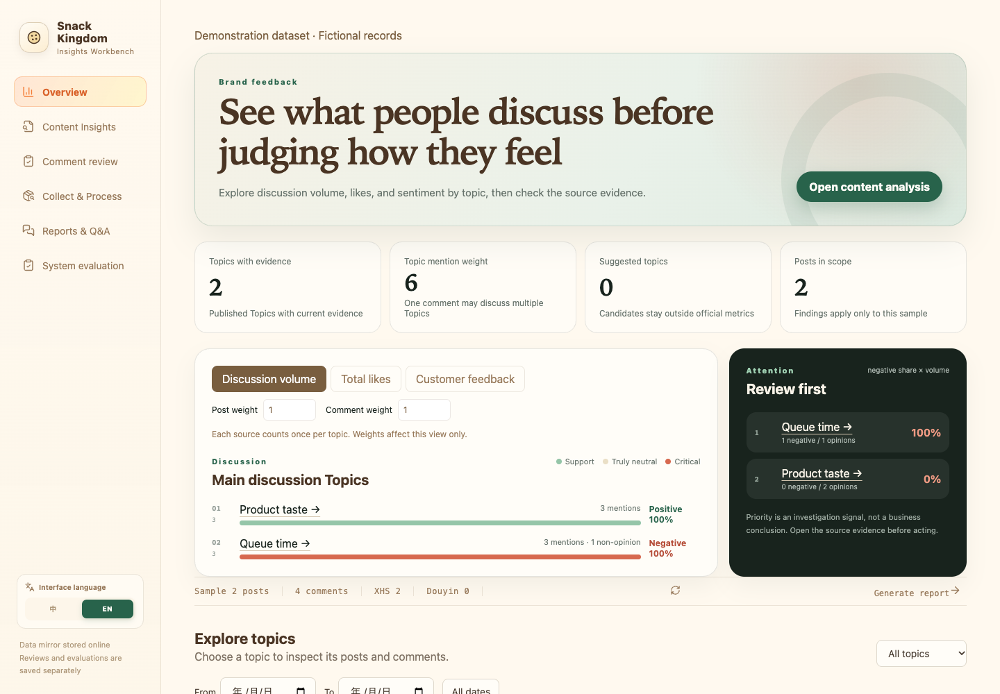
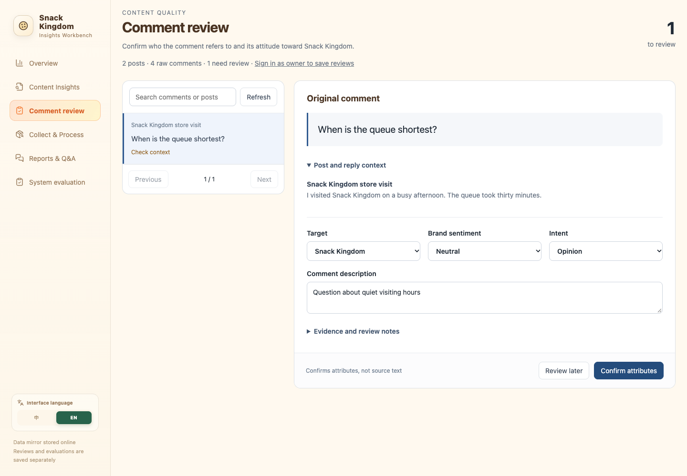
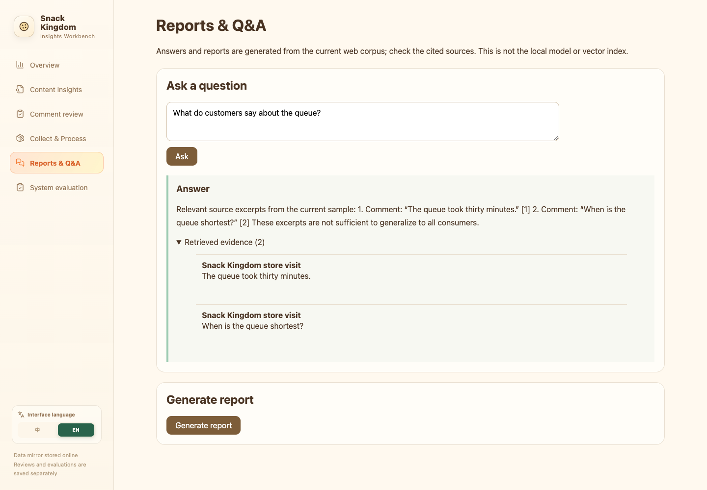

# Snack Kingdom · UGC Insights

A social-listening and LLM analytics platform built to help Snack Kingdom understand consumer feedback across social media. It turns scattered posts and comments into sentiment distributions, ranked topics and evidence-backed business summaries.

## Project background

The broader project crawled, cleaned and analyzed **849 posts and 12,738 comments from TikTok and RedNote**. Its central challenge is not simply detecting positive or negative language: a comment may be reacting to the creator rather than the brand, asking a practical question, or discussing a different subject entirely.

The system was designed around three priorities:

- **Understand comments in context.** Preserve the parent post and reply context when classifying brand relevance, sentiment and question intent; route uncertain classifications to review.
- **Turn recurring conversations into useful themes.** Combine embedding clustering with LLM topic normalization, then rank themes by mentions and likes without confusing discussion volume with sentiment.
- **Keep insights traceable.** Link answers and summaries to supporting posts and comments, maintain incremental retrieval indexes, and support custom evaluation questions, batch runs and citation checks.

In the broader project's Python/Ray pipeline, batched comment analysis and embedding generation achieved **7.9× throughput over a sequential baseline on an 800-comment benchmark (2.67 vs. 0.34 comments/s)**. This is a full-system benchmark, not a measurement of this repository's web runtime. The Python/Ray pipeline and its benchmark artifacts are not included here.

This repository contains the **web workbench and backend**, with fictional sample records for public exploration. The architecture documentation distinguishes the included implementation from the broader processing system.

## Interface preview

Screenshots show the English interface with fictional sample records.

### Topic-first overview

Compare discussion volume, engagement and sentiment, then explore the posts and comments behind each topic.

### Contextual comment review

Review each comment alongside its source post, classification and supporting context.

### Reports & evidence-linked Q&A

Ask questions about the corpus and inspect the source excerpts supporting each answer.

## Product

- **Topic-first overview:** discussion-volume and engagement rankings, sentiment breakdowns, trend charts, and topic-level source exploration.
- **Content insights:** searchable posts, contextual comments, source links, and processed records.
- **Consumer feedback:** grouped questions and feedback, ranked by comment count plus total likes.
- **Comment review:** contextual classification, source-text evidence, version checks, and persistent reviewer decisions.
- **Reports and Q&A:** source-linked retrieval, scope-aware statistics, report export, and insufficient-evidence responses.
- **Collection workspace:** bounded TikHub collection, contextual Qwen analysis, retryable jobs, and downloadable JSON records.
- **System evaluation:** editable question sets, bounded concurrent execution, evidence checks, latency measurements, and separate manual grading.

## Engineering

| Layer | Implementation |
| --- | --- |
| Frontend | React, TypeScript, Vite |
| Backend | TypeScript HTTP routes, Vinext, Worker runtime |
| Persistence | D1 / SQLite-compatible tables, Drizzle migrations, R2 object storage |
| Analysis | Context-aware classification, topic normalization, opinion/intent separation |
| Retrieval | Source-linked lexical retrieval; LangChain orchestration for the structured dataset API |
| Access control | Signed email sessions, owner-only mutations, separate machine credentials |
| Verification | Type checks, production builds, unit tests and HTTP/database integration tests |

The public repository includes fictional sample records for previews. Actual collected content, credentials, local databases and historical evaluation results are not included. The web runtime and optional external analysis service have distinct capabilities; see the architecture documentation for those boundaries.

## Repository

- [Frontend](frontend/) — application shell, overview, content explorer, review, collection, reports and evaluation.
- [Backend](backend/) — HTTP routes, processing services, access control, storage and migrations.
- [Architecture](docs/architecture.md)
- [Data processing and contracts](docs/data-processing.md)
- [API reference](docs/api-reference.md)
- [Developer guide](docs/development.md)
- [Security and operational boundaries](docs/security.md)
- [Verification record](docs/verification.md)
